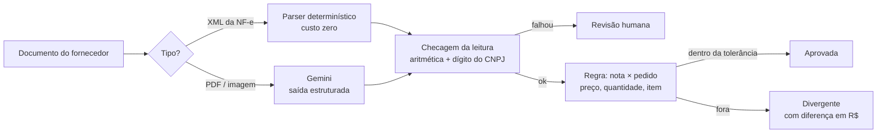

# Conferência de nota fiscal × pedido de compra

Um time financeiro confere à mão cada nota de fornecedor contra o pedido de compra.
Este projeto automatiza a conferência e usa LLM **só onde a regra não alcança**: nota
que chega em PDF ou escaneada. Toda decisão é tomada por código; o modelo só lê.

> Dados 100% sintéticos: fornecedores, CNPJs e produtos fictícios. O XML segue a estrutura
> da NF-e 4.00 de forma simplificada e sem assinatura.

## Como funciona



- **XML vai por regra.** A NF-e já é estruturada; ler XML com LLM seria pagar para errar.
- **O LLM só lê, nunca decide.** Formato válido (JSON no schema) não garante conteúdo certo,
  por isso toda leitura passa por checagens que não precisam de gabarito: quantidade ×
  preço = total do item, soma dos itens = total da nota e dígito verificador do CNPJ.
- **Erro falha fechado.** Leitura duvidosa, pedido não encontrado ou fornecedor diferente
  do pedido vão para revisão humana, nunca para aprovação.

## Resultado da leitura com LLM (F1)

`gemini-3.5-flash-lite`, 10 notas por condição, acerto campo a campo contra o gabarito
(IC95% de Wilson). Rodar: `python scripts/avaliar_extracao.py --n 10 --modelo gemini-3.5-flash-lite`.

| | DANFE limpo | DANFE escaneado |
|---|---|---|
| Campos corretos | 155/155 (100%, IC95% 97,6–100%) | 134/155 (86%, IC95% 80–91%) |
| Quantidade, preço e total | sem erro | sem erro |
| Campo que mais errou | — | descrição (11/21) e nº do pedido (5/10) |
| **Decisão igual à da nota verdadeira** | 10/10 | 5/10 |
| **Decisão errada para o lado perigoso** (aprovar o que devia barrar) | 0/10 | 0/10 (IC95% 0–28%) |
| Tokens por nota (entrada/saída) | ≈ 710 / 300 | ≈ 1.270 / 300 |

**Leitura de negócio.** Acerto por campo não é a métrica que importa. No escaneado, 86% dos
campos certos ainda deram 0 decisões perigosas, porque a regra depende dos números (que
vieram certos) e o erro de texto cai em revisão. O custo aparece em outro lugar: metade dos
escaneados foi para revisão humana sem precisar. Os próximos degraus, do mais barato ao
mais caro:
1. pedir o XML ao fornecedor (zera o problema);
2. casar pedido e item por similaridade quando o código vem ilegível (regra, sem LLM);
3. só então testar modelo maior.

**Limites.** n = 10 por condição, dados sintéticos e um único layout de DANFE. O ruído do
"escaneado" é simulado. O número serve para comparar degraus, não para prometer acerto em
produção.

### Predição registrada antes de medir

| | Predição | Medido |
|---|---|---|
| Acerto no DANFE limpo | ~90% | 100% (IC95% 97,6–100%) |
| Acerto no escaneado | ~90% | 86% (IC95% 80–91%) |
| Campo que mais erra | descrição e CNPJ | descrição e nº do pedido; CNPJ errou 1/10 e foi barrado pelo dígito verificador |

## Como rodar

```bash
pip install -r requirements.txt
export GEMINI_API_KEY=...       # opcional: GEMINI_MODEL (padrão gemini-2.5-flash)
python -m conferencia_nf.gerar_dados --n 30 --saida data
python -m pytest -q             # não chama API
uvicorn api:app --port 8000     # POST /conferir com o arquivo
```

## Estrutura

| Arquivo | Papel |
|---|---|
| `conferencia_nf/roteador.py` | Decide o caminho pelo conteúdo do arquivo, não pela extensão |
| `conferencia_nf/extrator_xml.py` | Parser da NF-e, protegido contra XXE |
| `conferencia_nf/extrator_llm.py` | Gemini com schema; conta tokens de raciocínio no custo |
| `conferencia_nf/conferencia.py` | Regra de negócio e tolerâncias |
| `conferencia_nf/gerar_dados.py` | Pedidos, XML, DANFE e DANFE escaneado sintéticos |
| `scripts/avaliar_extracao.py` | Acerto por campo, decisão vs gabarito, tokens |
| `api.py` | Endpoint que o n8n chama (F2) |
| `docs/adr/` | Decisões de arquitetura |

## Próximas fases

- **F2**: n8n recebe o documento por webhook, chama a API, grava o resultado e avisa o
  revisor quando precisa de humano.
- **F3**: agente com ferramentas só de leitura para explicar as divergências, com teste de
  prompt injection escrito dentro do PDF.
- **F4**: custo por nota em R$ e conta de retorno para um time de conferência.
